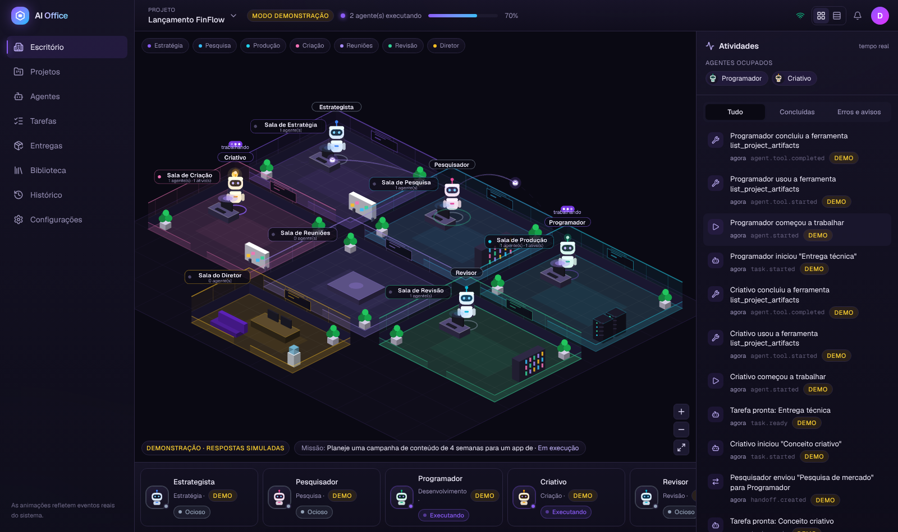
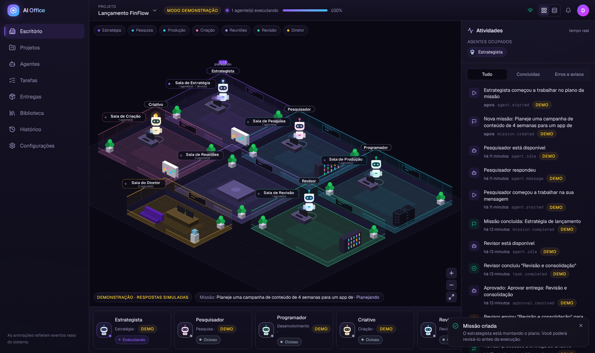
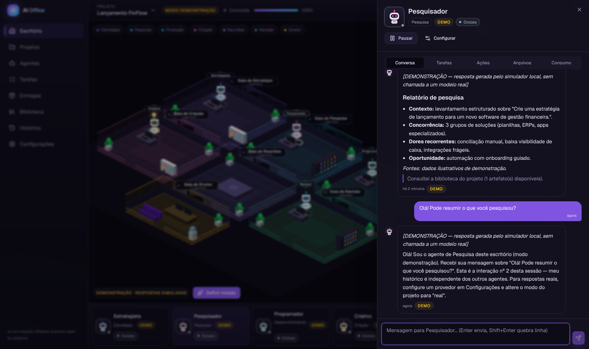
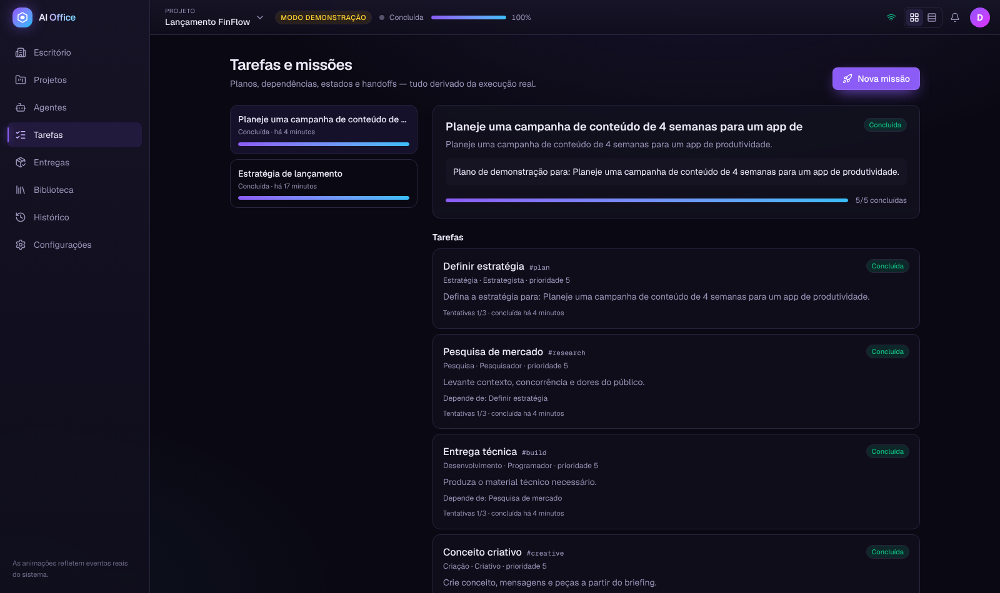
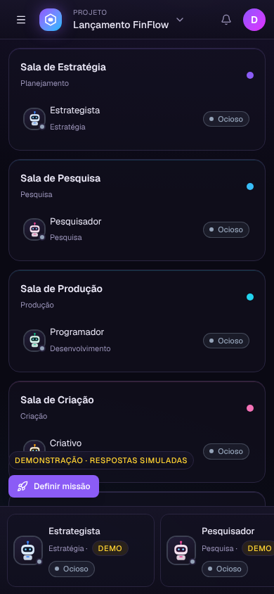

# AI Office

**Escritório virtual isométrico para orquestrar agentes de IA reais.**
Cada funcionário do escritório é uma instância independente de um agente (Anthropic ou OpenAI) com sessão, histórico, função e limites próprios. Você define uma missão, aprova o plano, acompanha a execução em tempo real, conversa com qualquer agente e revisa as entregas. A animação reflete o estado real do sistema — nunca o contrário.



| Aprovação do plano            | Chat com streaming        | Tarefas e handoffs         | Celular                     |
| ----------------------------- | ------------------------- | -------------------------- | --------------------------- |
|  |  |  |  |

## Destaques

- **Escritório isométrico** (PixiJS): 7 salas clicáveis, robôs com estados reais (ocioso, executando, na fila, aguardando aprovação, pausado, erro), animação de handoff entre agentes, câmera com pan/zoom/pinça.
- **Agentes independentes**: várias instâncias do mesmo modelo com históricos separados e persistentes; trava de concorrência por sessão.
- **Orquestrador multiagente**: missão → plano estruturado (validado) → aprovação humana → tarefas com dependências, prioridade, retentativas, cancelamento → handoffs formais → artefatos versionados → aprovação final.
- **Tempo real** via SSE com replay por `Last-Event-ID` e sem duplicatas.
- **Modo demonstração** sem chaves de API (tudo rotulado como DEMO) e **modo real** com os SDKs oficiais.
- **Governança**: autenticação, autorização por workspace, chaves criptografadas, limites de gasto/execução, auditoria.

## Stack

pnpm + Turborepo · TypeScript strict · Next.js 16 (App Router) · React 19 · Tailwind 4 · componentes estilo shadcn/ui (Radix) · Lucide · Motion · Zustand · TanStack Query · PixiJS 8 + @pixi/react · Fastify 5 · Zod 4 · PostgreSQL + Drizzle · Redis + BullMQ · Better Auth · `@anthropic-ai/sdk` · `openai` · S3/MinIO · Vitest · Playwright · GitHub Actions · Docker.

## Estrutura

```
apps/
  web/        Next.js — escritório, painéis e páginas (proxy /api → API)
  api/        Fastify — auth, REST, SSE, uploads
  worker/     BullMQ — planejamento, tarefas, chats
packages/
  shared/         domínio, eventos, schemas Zod, plantas das salas
  database/       schema Drizzle + migrações
  agents/         adaptadores Anthropic/OpenAI/Demo, preços, prompts, cripto
  orchestrator/   missões, tarefas, handoffs, sessões, consumo, eventos
  office-engine/  projeção isométrica, layout, reducer de estado visual
  ui/             design system
infra/docker/  Dockerfile multi-target · docs/ · tests/e2e/ · .github/workflows/
```

## Começando (desenvolvimento local)

Requisitos: Node ≥ 22, pnpm 10, Docker (ou PostgreSQL 16 + Redis 7 instalados).

```bash
pnpm install
```

```bash
cp .env.example .env   # depois gere BETTER_AUTH_SECRET e ENCRYPTION_KEY (openssl rand -base64 48)
```

```bash
pnpm services:up       # PostgreSQL e Redis (cria também o banco aioffice_test)
```

```bash
pnpm build && pnpm db:migrate && pnpm db:seed
```

```bash
pnpm dev               # web :3000 · api :4000 · worker
```

Abra http://localhost:3000 e clique em **Explorar o escritório demo** (usuário `demo@aioffice.dev` / `aioffice-demo`, criado pelo seed com uma missão já executada), ou crie sua conta.

> O worker é um processo separado: a execução das tarefas não depende de nenhuma requisição HTTP aberta.

### Comandos

| Comando                                              | Ação                                                                       |
| ---------------------------------------------------- | -------------------------------------------------------------------------- |
| `pnpm dev`                                           | web, API e worker em modo watch                                            |
| `pnpm build`                                         | build de produção de todos os pacotes                                      |
| `pnpm start`                                         | inicia os builds de produção                                               |
| `pnpm db:generate`                                   | gera migração a partir do schema                                           |
| `pnpm db:migrate`                                    | aplica migrações                                                           |
| `pnpm db:seed`                                       | cria usuário e escritório demo                                             |
| `pnpm lint` · `pnpm typecheck` · `pnpm format:check` | qualidade                                                                  |
| `pnpm test`                                          | testes unitários e de integração (exigem Postgres e Redis)                 |
| `pnpm test:e2e`                                      | Playwright (servidores em execução; `E2E_START_SERVERS=1` para iniciá-los) |
| `docker compose --profile app up -d --build`         | stack completa em containers                                               |

## Configurando as APIs de IA (modo real)

### Sem custo: Groq (recomendado para começar)

1. Crie uma chave gratuita em [console.groq.com/keys](https://console.groq.com/keys).
2. No AI Office, abra **Configurações → Provedores**, cole a chave no cartão **Groq** e clique em **Salvar**.
3. Clique em **Verificar conexão**: o app lista os modelos de texto disponíveis na API do Groq (nenhum ID de modelo é fixo no código).
4. Escolha o **modelo padrão** e salve.
5. Crie um projeto em modo **Real** (a equipe inicial já usa o Groq quando ele é o provedor configurado) ou ajuste cada agente para o provedor Groq.

O plano gratuito do Groq tem limites por minuto e por dia (por organização). Para respeitá-los, o AI Office usa, por padrão no Groq: **1 execução por vez**, até **1.500 tokens de resposta**, histórico cortado em ~3.500 tokens e nova tentativa automática com espera crescente quando recebe erro 429. A opção "Conta no plano gratuito" registra o custo como US$ 0.

> Não envie dados sensíveis da empresa a serviços externos; leia os termos do provedor.

### Outras opções

| Provedor               | Custo                                        | Observação                                                                                                       |
| ---------------------- | -------------------------------------------- | ---------------------------------------------------------------------------------------------------------------- |
| **Ollama (local)**     | sem custo                                    | Modelos na sua máquina; informe o endereço (padrão `http://localhost:11434/v1`). Desempenho depende do hardware. |
| **OpenRouter**         | gratuito em modelos `:free`, pago nos demais | Marque "Conta no plano gratuito" só se usar apenas modelos gratuitos.                                            |
| **Anthropic / OpenAI** | pago por token                               | Preços da Anthropic pré-carregados (tabela publicada); os da OpenAI você informa em **Configurações → Preços**.  |

As chaves são criptografadas no servidor (AES-256-GCM) e nunca voltam ao navegador. Sem preço configurado, o custo aparece como "desconhecido" — nunca estimado. Variáveis de ambiente em [`.env.example`](.env.example).

## Documentação

- [Arquitetura](docs/ARCHITECTURE.md) · [Especificação do produto](docs/PRODUCT_SPEC.md) · [Plano](docs/IMPLEMENTATION_PLAN.md)
- [Progresso e pendências](docs/PROGRESS.md) · [Decisões](docs/DECISIONS.md)
- [Implantação](docs/DEPLOYMENT.md) · [Segurança](docs/SECURITY.md)

## Estado atual

Verificado nesta versão: lint, typecheck, build de produção, **59 testes** unitários/integração (com Postgres, Redis e BullMQ reais) e **e2e** do fluxo completo em modo demonstração pela UI. Os adaptadores Anthropic/OpenAI foram testados com respostas HTTP simuladas dos SDKs oficiais; chamadas reais dependem das suas chaves. Detalhes e limitações em [docs/PROGRESS.md](docs/PROGRESS.md).
